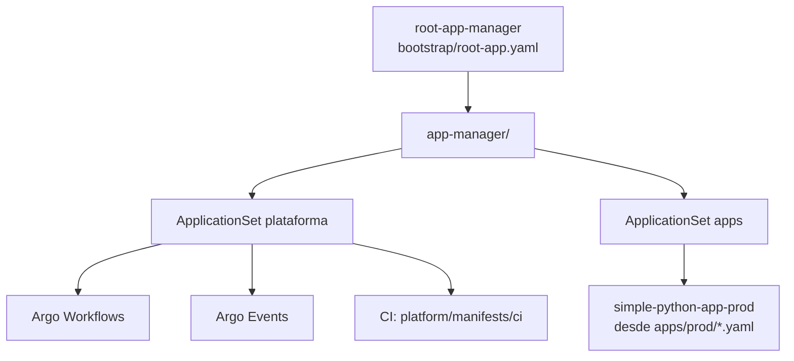
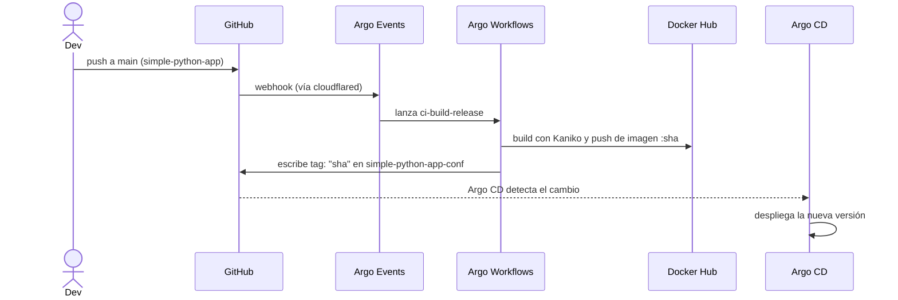

# argocd-deploy

Demo de GitOps local: una app Python que se construye y despliega sola con cada push, usando **Argo CD**,
**Argo Workflows** y **Argo Events** sobre **minikube**.

> Esta demo está atada a la organización `diegodevopsorgs` y a credenciales propias (GitHub y Docker Hub). No
> funciona tal cual para otra persona. Sirve como guía para entender cómo está armada.

## Repos

| Repo | Contenido |
|---|---|
| `argocd-deploy` (este) | Plataforma: Argo CD, Workflows, Events, el CI y la lista de apps |
| `simple-python-app` | Código de la app y su `Dockerfile` |
| `simple-python-app-conf` | Chart de Helm de la app; `tags-prod.yaml` con el tag de imagen lo escribe el CI |

## Cómo funciona

Solo `bootstrap/root-app.yaml` se aplica a mano. Todo lo demás lo instala Argo CD leyendo Git:



Ciclo de un cambio en la app:



## Agregar una app nueva

Cada app son **2 repos + 1 archivo** en `apps/prod/`. El CI y Argo CD se basan en esta convención de nombres, así
que no hay que tocar nada de la plataforma:

| Qué | Dónde | Contenido |
|---|---|---|
| Código | repo `<app>` | `Dockerfile` en la raíz |
| Configuración | repo `<app>-conf` | Chart de Helm con `values.yaml`, `values-prod.yaml` y `tags-prod.yaml` (copiar `simple-python-app-conf` como base) |
| Alta | `apps/prod/<app>.yaml` en este repo | ver abajo |

```yaml
# apps/prod/mi-app.yaml
name: mi-app
enabled: "true"          # "false" = baja: Argo CD borra la app del cluster
repoURL: https://github.com/diegodevopsorgs/mi-app-conf.git
targetRevision: main
namespace: mi-app
```

Al pushear ese archivo, el ApplicationSet `apps-prod` crea la Application `mi-app-prod`. Para que el CI la
construya, falta configurar el webhook en el repo **de código** (no en el `-conf`, porque el CI commitea ahí y se
dispararía en bucle). El token y los secrets ya cubren todos los repos de la organización.

Para dar de baja una app, poner `enabled: "false"` o borrar su archivo.

## Correrlo con cuentas propias

Clonar y ejecutar **no alcanza**: la organización de GitHub (`diegodevopsorgs`) y el usuario de Docker Hub
(`diego1986`) están escritos en los manifiestos. Hay que:

1. **Copiar los 3 repos** a una organización propia (los nombres pueden quedar igual).
2. **Reemplazar `diegodevopsorgs`** por esa organización en:
   - `bootstrap/root-app.yaml` y `bootstrap/entorno_local.py` (`ORG`)
   - `app-manager/*.yaml` (AppProject y los 3 ApplicationSets)
   - `apps/prod/simple-python-app.yaml`
   - `platform/manifests/ci/03-sensor.yaml` y `04-workflowtemplate.yaml` (`owner`)
3. **Reemplazar `diego1986`** por el usuario de Docker Hub propio en `platform/manifests/ci/04-workflowtemplate.yaml`
   (`image-namespace`) y en `simple-python-app-conf/values-prod.yaml`.
4. **Crear las credenciales** y ponerlas en `bootstrap/.env` (copiar `.env.example`):
   - `GH_TOKEN`: token *fine-grained*, *Resource owner* = la organización, *Contents: Read and write*.
   - `DOCKERHUB_USER` / `DOCKERHUB_TOKEN`: access token de Docker Hub con *Read & Write*.
5. **Pushear** los cambios a los repos propios, porque Argo CD lee de GitHub y no de la copia local.

Después, con Docker Desktop, `minikube`, `kubectl` y Python 3:

```powershell
cd argocd-deploy/bootstrap
python entorno_local.py crear     # verifica credenciales, cluster, Argo CD, secrets, root-app y abre las UIs
python entorno_local.py abrir     # solo reabre las UIs
```

| UI | URL | Login |
|---|---|---|
| Argo CD | https://localhost:8080 | `admin` + contraseña impresa |
| Argo Workflows | http://localhost:2746 | `Bearer …` impreso |
| Webhook | http://localhost:12000/push | sin login |

Para que un push dispare el CI, hay que exponer el webhook (`cloudflared tunnel --url http://localhost:12000`) y
cargar en GitHub (*Settings → Webhooks* de `simple-python-app`) la URL pública que devuelve, terminada en `/push`.

Para empezar de cero: `minikube delete -p minikube` y volver a correr `crear`.
